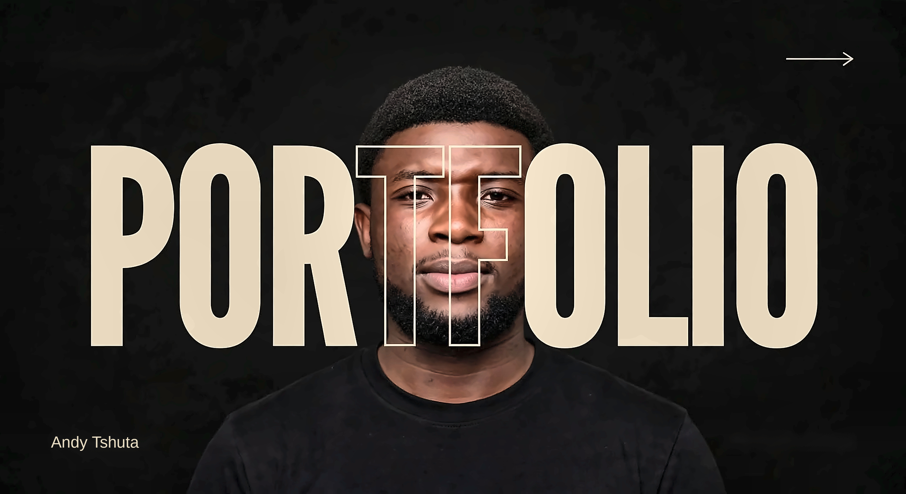

  

  

 

  
  
  
  
   
  
  

 

---

  

Bonjour ! Je suis **Andy Tshuta**, développeur **Full-Stack** et **UI/UX Designer**, passionné par la création de solutions numériques modernes, évolutives et centrées sur l'utilisateur.

J'associe compétences techniques et sens créatif pour transformer des idées en expériences numériques concrètes.

<table width="100%">
  <tr>
    <td width="50%">💻 Applications web modernes et responsives</td>
    <td width="50%">🎨 Interfaces intuitives et esthétiques</td>
  </tr>
  <tr>
    <td>⚙️ Systèmes backend et API RESTful</td>
    <td>🗄️ Bases de données et architecture applicative</td>
  </tr>
  <tr>
    <td>🧩 Idées complexes → solutions pratiques</td>
    <td>🤝 Ouvert aux collaborations et projets innovants</td>
  </tr>
</table>

> 💡 **Ma philosophie :** un excellent logiciel allie fonctionnalité, performance et expérience utilisateur exceptionnelle.

---

  

<table width="100%">
  <tr>
    <td width="30%"><b>🌐 Frontend</b></td>
    <td width="70%"></td>
  </tr>
  <tr>
    <td width="30%"><b>⚙️ Backend</b></td>
    <td width="70%"></td>
  </tr>
  <tr>
    <td width="30%"><b>🎨 UI/UX</b></td>
    <td width="70%"></td>
  </tr>
  <tr>
    <td width="30%"><b>🗄️ Bases de données</b></td>
    <td width="70%"></td>
  </tr>
  <tr>
    <td width="30%"><b>💅 Styling</b></td>
    <td width="70%"></td>
  </tr>
  <tr>
    <td width="30%"><b>🧰 Outils de dev</b></td>
    <td width="70%"></td>
  </tr>
  <tr>
    <td width="30%"><b>🔀 Versioning</b></td>
    <td width="70%"></td>
  </tr>
  <tr>
    <td width="30%"><b>🎬 Multimédia</b></td>
    <td width="70%"></td>
  </tr>
</table>

---

  

  

  

<i>Fier d'avoir contribué à l'open source 🤍</i>

---

  

  

---

  

  <picture>
    <source media="(prefers-color-scheme: dark)" srcset="https://raw.githubusercontent.com/andytshuta01-web/andytshuta01-web/output/github-snake-dark.svg" />
    <source media="(prefers-color-scheme: light)" srcset="https://raw.githubusercontent.com/andytshuta01-web/andytshuta01-web/output/github-snake.svg" />
    
  </picture>

---

  

  
  
  

---

  

  

 

  
   
  <i>« Great things are built one commit at a time. »</i>

  

